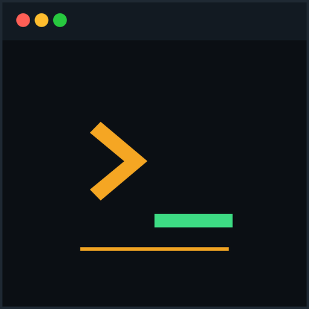
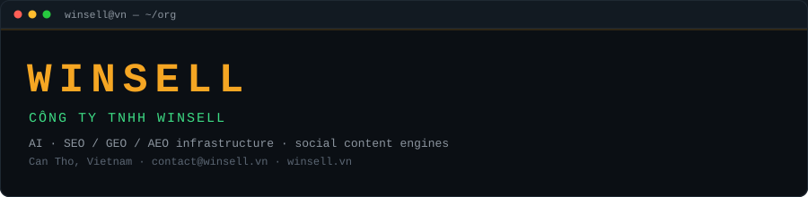
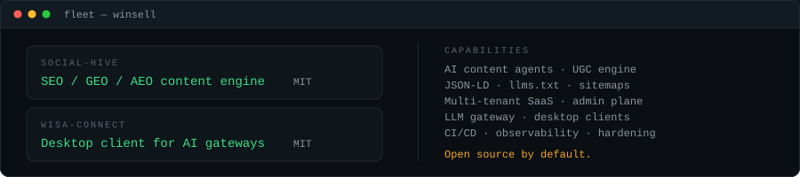

<p align="center">
  
</p>

<p align="center">
  
</p>

<p align="center">
  <a href="https://winsell.vn"></a>
  <a href="https://github.com/winsell-vn/social-hive"></a>
  <a href="https://github.com/winsell-vn/wisa-connect"></a>
  
  
</p>

<p align="center"><b>WinSell</b> builds the infrastructure layer for AI search: content engines, GEO/AEO pipelines and gateways for AI clients.</p>

---

### // products

<table>
<tr>
<td valign="top" width="50%">

#### [`social-hive`](https://github.com/winsell-vn/social-hive)

Full-stack SEO/GEO/AEO social content engine.

- NestJS 11 + Next.js 16 + Prisma
- AI content agents, post-to-blog sync
- JSON-LD, `llms.txt`, sitemap pipeline
- Real admin control plane, multi-tenant
- 608 source files · 72,898 LOC · 195 endpoints
- **MIT** · template repository · `v1.0.0`

</td>
<td valign="top" width="50%">

#### [`wisa-connect`](https://github.com/winsell-vn/wisa-connect)

Desktop client for the WISA gateway.

- Rust + Tauri v2 + React + Vite
- Sign in with Google, AI clients wired automatically
- Works with Claude Code, Codex CLI, Claude Desktop
- No terminal required
- **MIT** · Windows + macOS

</td>
</tr>
</table>

<p align="center">
  
</p>

---

### // stack

```text
backend    TypeScript · NestJS 11 · Prisma · MySQL · Redis · Bull
frontend   Next.js 16 · React · Tailwind · Radix · TanStack Query · Zustand
systems    Rust · Tauri v2 · Docker · GitHub Actions
ai         Groq · LLM agents · prompt routing · RAG
web        JSON-LD · llms.txt · sitemap · canonical · hreflang
```

---

### // policy

- Security reports → [private advisories](https://github.com/winsell-vn/social-hive/security/advisories/new) or `contact@winsell.vn`
- Contributions → see [CONTRIBUTING.md](https://github.com/winsell-vn/.github/blob/main/CONTRIBUTING.md)
- Code of conduct → see [CODE_OF_CONDUCT.md](https://github.com/winsell-vn/.github/blob/main/CODE_OF_CONDUCT.md)
- Governance → see [GOVERNANCE.md](https://github.com/winsell-vn/.github/blob/main/GOVERNANCE.md)

---

<p align="center">
  <a href="https://winsell.vn"><b>winsell.vn</b></a>
  &nbsp;·&nbsp;
  <a href="mailto:contact@winsell.vn">contact@winsell.vn</a>
  &nbsp;·&nbsp;
  <span>Can Tho, Vietnam</span>
</p>

<p align="center">
  <sub>All public repositories in this organization are released under the MIT license unless stated otherwise.</sub>
</p>
